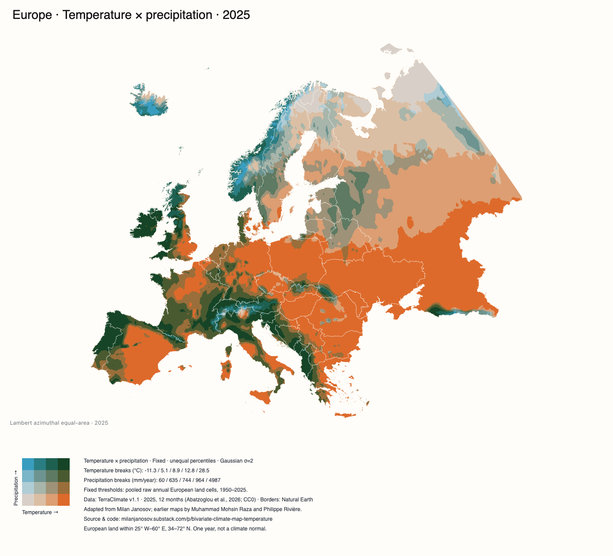

# Bivariate climate map

[Open the interactive map](https://www.danielpradilla.info/projects/bivariate-climate-map/) · [Run the explanatory notebook](climate-map.ipynb) · [Project blog post](https://www.danielpradilla.info/blog/?p=2468) (available from 24 October 2026, 09:00 UTC)

The app shows the blog post's publication date until 24 October 2026 at 09:00 UTC, then enables its link on page load.

Annual temperature and precipitation maps for Europe, Asia, Africa, North America, South America, Oceania, Antarctica and World. The full dataset contains 608 frames: eight views × 76 years, from 1950 through 2025. The browser app supports year playback, raw/smoothed zones, grid-cell inspection and PNG export.



## 1. Download assets and run the app

The repository contains source code and previews, not the `data/` folder. The existing `scripts/download_assets.py` script recreates the folder, including manifests, from the published site. Install [uv](https://docs.astral.sh/uv/), then run these commands from the project root:

```sh
# Full published history for all eight views, approximately 4.4 GB.
uv run --with-requirements requirements-data.txt python scripts/download_assets.py --start-year 1950 --end-year 2025
python3 -m http.server 8000
```

Open <http://localhost:8000/>. Use HTTP rather than opening `index.html` as a file. D3 is vendored locally; the app needs no build step.

To recover after deleting `data/`, rerun the full download command above. Removing the folder frees approximately 4.4 GB; the local app cannot display maps until assets are downloaded again. Recovery requires network access and the published site to remain available. The upstream rebuild commands in section 3 are an alternative if published assets are unavailable.

The downloader restores browser assets and annual provenance, not builder-only source caches (the Natural Earth ZIP, catalog and dataset XML, and acquisition receipts). The builders reacquire those from upstream; original acquisition timestamps are not reproduced.

For a smaller preview, replace the download command with:

```sh
uv run --with-requirements requirements-data.txt python scripts/download_assets.py --region world --start-year 2024 --end-year 2025
```

`--start-year` and `--end-year` select an inclusive period. Both default to the current calendar year when omitted. For one year, pass the same value to both. Published assets currently cover 1950 through 2025, so the current-year default reports unavailable frames until that year's assets are published; it never silently substitutes the latest available year.

To request only the current year:

```sh
uv run --with-requirements requirements-data.txt python scripts/download_assets.py
```

`--region` is repeatable, for example `--region europe --region asia`. Region ids are `europe`, `asia`, `africa`, `north-america`, `south-america`, `oceania`, `antarctica` and `world`. `--output-dir PATH` chooses another asset directory; the app normally reads `data/`.

The downloader uses the fixed [live site's asset root](https://www.danielpradilla.info/projects/bivariate-climate-map/data/regions/index.json), streams files with at most four concurrent HTTP requests, verifies published SHA256 hashes where available, and replaces files atomically. Valid existing hashed assets are reused. Files without a published hash are fetched and checked as JSON or gzip. Nothing outside its own temporary `.part` files is deleted.

A limited download edits local manifests: `years`, `frames` and `defaultYear` advertise only the selected complete frames, while the registry advertises only selected regions. Default-frame file references are updated too. Historical physical thresholds, ranges and baseline fields remain unchanged; `sourceBaseline` is preserved or recorded from the source manifest. Extra files from previous downloads stay on disk but are not advertised. Running the full download restores exact published manifests without recomputing thresholds. All downloaded assets and manifests are ignored by Git.

## 2. Run the notebook from monthly source data

[climate-map.ipynb](climate-map.ipynb) explains the source, monthly arithmetic, land selection, historical classes and smoothing before producing all seven continent maps and World. Its defaults are `YEAR = 2025` and all eight region ids. It downloads actual upstream monthly NetCDF fields, rather than tracing the preview or reading annual browser grids.

```sh
uv run --with-requirements requirements-notebook.txt jupyter lab climate-map.ipynb
```

To execute every cell without opening Jupyter:

```sh
mkdir -p notebook-output
uv run --with-requirements requirements-notebook.txt jupyter nbconvert \
  --to notebook --execute climate-map.ipynb \
  --output climate-map.executed.ipynb --output-dir notebook-output \
  --ExecutePreprocessor.timeout=-1
```

Upstream sources are cached outside the repository at `~/.cache/bivariate-climate-map/notebook`. Figures, provenance and the executed notebook go in `notebook-output/`. The committed notebook has no outputs. It uses downloaded historical manifests for published thresholds when available, otherwise it fetches them from the live site. Downloading browser assets is not a prerequisite for notebook execution. Global sources and native-resolution continent plots require substantial disk space and memory.

Verified with the default 2025 execution: all eight PNGs were generated, and complete-cell counts matched the published 2025 frames. A two-region, two-year asset preview exercised the notebook's canonical-manifest fallback without changing the preview files.

## 3. Rebuild the browser data

To reproduce Europe directly from upstream sources:

```sh
uv run --with-requirements requirements-data.txt python scripts/build_data.py
```

To build the remaining continent and World assets while preserving Europe:

```sh
uv run --with-requirements requirements-data.txt python scripts/build_data.py --regions
```

For a complete clean-source rebuild, run both commands in that order. They default to 1950 through 2025. `--output-dir PATH` permits an isolated build; both accept `--start-year` and `--end-year`. A shortened source rebuild fits thresholds to its requested years and is not equivalent to downloading a preview with the published historical thresholds.

Europe's source cache defaults to `/tmp/bivariate-climate-map-source-cache` and can be changed with `--cache-dir`. The region builder stages one year's upstream temperature and precipitation files in an owned temporary directory and removes those staged files after export. It preserves existing caches. Annual provenance records include source URLs, hashes, monthly dates and CF packing.

## 4. Method and limitations

TerraClimate v1.1 supplies monthly maximum temperature (`tmax`) and precipitation (`ppt`). CF fill values, scale factors and offsets are decoded from the source files. Annual temperature is the arithmetic mean of all 12 monthly maximum-temperature fields; precipitation is the sum of all 12 monthly totals. Each displayed cell requires complete monthly coverage for both variables. Temperature is stored at 0.01°C precision and precipitation at 1 mm.

Continents retain the native 1/24° grid, approximately 4 km at the equator. World samples every sixth source cell, approximately 28 km, without spatial averaging. Natural Earth polygons select land at grid-cell centres. Europe retains the original country-tag selection clipped to 25°W–60°E and 34°N–72°N. Asia additionally includes Russia east of 60°E and its eastern antimeridian components west of 160°W. Other continents use Natural Earth's country-continent tags, including overseas components with their parent country. These selections do not form an exhaustive physical-continent partition; World includes all Natural Earth land.

The 4×4 palette combines four temperature classes and four precipitation classes. Published thresholds pool encoded unsmoothed land-cell/year observations across 1950 through 2025, using temperature percentiles `[0, 20, 45, 70, 100]` and precipitation percentiles `[0, 60, 78, 90, 100]`. Each cell-year has equal weight, not equal land area. Thresholds remain fixed across years within a region; they differ between regions. Use World for a common cross-continent scale.

Default smoothing fills invalid cells with the region's annual valid-field mean, applies a Gaussian filter with sigma 2 grid cells, then restores the original mask. This biases coastal and mask-edge values toward the regional mean. World smoothing spans a larger physical distance. Inspect raw values or disable smoothing for local readings. Grid-cell readings are not weather-station observations; missing coastal cells remain unavailable.

TerraClimate v1.1 revises the data used by earlier tutorials. The same palette and calculation need not produce identical classes or pixels across versions. Country borders provide context, not a statement about sovereignty. The nearest-cell categorical rendering does not interpolate class colours.

## 5. Repository data policy

Git tracks application code, builders, the downloader, dependency files, the output-free notebook, previews, D3 and its license.

The entire `data/` folder, source caches and `notebook-output/` are excluded. They are recreated by the downloader, builders or notebook. A source-only clone therefore needs an asset download before the browser app can display climate frames. Local publication drafts `POST.md` and `REDDIT.md` are also ignored.

## 6. Credits and source licenses

- [Milan Janosov's bivariate climate map article](https://milanjanosov.substack.com/p/bivariate-climate-map-temperature) and [video walkthrough](https://www.youtube.com/watch?v=iWRp_dciJsM): palette, percentile choices and Gaussian smoothing method.
- [Muhammad Mohsin Raza's Datawim tutorial](https://www.datawim.com/post/creating-professional-bivariate-maps-in-r/): earlier bivariate mapping work in R.
- [Fil / Philippe Rivière's Pangea example](https://fil.github.io/pangea/plot/bivariate-map) and [source](https://github.com/Fil/pangea): earlier bivariate mapping example.
- [TerraClimate v1.1](https://www.climatologylab.org/terraclimate.html), Abatzoglou, Hegewisch, Yin and Kalashinkov (2026): monthly climate data, CC0 1.0 as recorded in the downloaded NetCDF files. See also the [foundational 2018 paper](https://doi.org/10.1038/sdata.2017.191), Abatzoglou, Dobrowski, Parks and Hegewisch.
- [Natural Earth](https://www.naturalearthdata.com/about/terms-of-use/): public-domain country boundaries.
- [D3](https://d3js.org/), Mike Bostock and contributors: browser projection and interaction, [ISC license](vendor/d3.LICENSE).

These are the licenses of the credited sources; they do not establish a separate license for this repository.
